<a href="https://boredandra.vercel.app/">
  <picture>
    <source media="(max-width: 600px)" srcset="assets/hero-mobile.svg">
    
  </picture>
</a>

  <a href="https://boredandra.vercel.app/">portfolio</a> ·
  <a href="mailto:andrahijati@gmail.com">email</a> ·
  <a href="https://instagram.com/andrahijati">instagram</a> ·
  <a href="https://web.facebook.com/andra.nugroho.921">facebook</a> ·
  discord <code>legacyy5030</code>

<picture>
  <source media="(max-width: 600px)" srcset="assets/pipeline-mobile.svg">
  
</picture>

### `$ kubectl get nodes`

<picture>
  <source media="(max-width: 600px)" srcset="assets/rack-mobile.svg">
  
</picture>

### `$ docker ps`

| Project | What it does |
|---|---|
| **[PT. KBN ↗](https://kbn.enama.my.id)** HTML · JavaScript | Company profile for PT Karya Bersama Nugroho, Bogor: software, catering and laundry |
| **[NexoTech Solutions ↗](https://nexotech.enama.my.id)** Astro · TypeScript | Smart, secure digital transformation for growing businesses |
| **[Docker Fundamental ↗](https://my-docker-nine.vercel.app)** Web | Container course from zero: 16 modules, theory and hands-on labs |
| **[ASCII Studio ↗](https://asciidashboard.vercel.app)** TypeScript | ASCII art engine with GPU acceleration |
| **[Nur Qur'an ↗](https://nur-quran.enama.my.id)** TypeScript | Digital Quran with tajweed |
| **[Materi TKJ ↗](https://tkj-materi-web.vercel.app)** Web | SMK Computer & Network Engineering curriculum: 6 modules, theory and labs |
| **[Bash Scripting ↗](https://my-bash.vercel.app)** Web | Shell scripting course from zero: 12 modules, theory and hands-on labs |
| **[Gedung Haji Bate ↗](https://gedunghajibate.vercel.app)** TypeScript | Event venue management and booking |

### `$ curl -s localhost:3000/api/dashboards/andra`

<picture>
  <source media="(max-width: 600px)" srcset="assets/telemetry-mobile.svg">
  
</picture>

<code>➜ ./deploy --prod --boring</code> · every SVG here is hand-rolled by <a href="generate_svg.py"><code>generate_svg.py</code></a>

