  <i>I automate the boring parts so the servers stay boring — the way infrastructure should be.</i> 
  <a href="https://boredandra.vercel.app/">portfolio</a> ·
  <a href="mailto:andrahijati@gmail.com">email</a> ·
  <a href="https://instagram.com/andrahijati">instagram</a>

### `$ kubectl get nodes --show-labels`

### `$ docker ps --format "table {{.Names}}\t{{.Status}}"`

| Project | What it does | Stack | |
|---|---|---|---|
| **GreenFog** | SaaS platform for scalable web workflows | Next.js · Tailwind | [live ↗](https://greenfog-dev.enama.my.id) |
| **MacBar Monitor** | Real-time system metrics in the macOS menu bar | Swift · SwiftUI | — |
| **Termifore** | Web application | TypeScript | [live ↗](https://t-app.enama.my.id) |
| **Invoice App** | Invoice generator for PT Asa Panca Cipta Optima | Web | [live ↗](https://invoice-app-mauve-alpha.vercel.app) |
| **MODULin** | *Bikin modul ajar jadi gampang* | Web | [live ↗](https://modulin.enama.my.id) |
| **Calistung** | Early learning & interactive literacy practice | Next.js · Vercel · Tailwind | [live ↗](https://calistung.enama.my.id) |
| **Nexotech Enama** | Company landing page & portal | React · Vercel · Tailwind | [live ↗](https://nexotech.enama.my.id) |
| **Nexotech Solutions AI** | AI assistant & chat widget suite | Next.js · OpenAI API | [live ↗](https://nexotech-assistant.enama.my.id) |
| **Nur Quran** | Digital Quran platform | React · API integration | [live ↗](https://nur-quran.enama.my.id) |
| **Enama Laundry** | Laundry business management portal | Next.js · Vercel · Tailwind | [live ↗](https://laundry.enama.my.id) |

### `$ curl -s localhost:3000/api/dashboards/andra`

<code>➜ ./deploy --prod --boring</code> · every SVG here is hand-rolled by <a href="generate_svg.py"><code>generate_svg.py</code></a> and re-rendered daily by GitHub Actions

