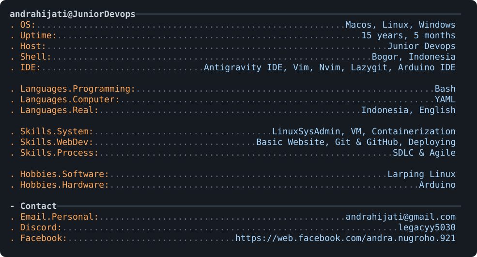

<a href="https://github.com/SakamotoMrX/SakamotoMrX">
  <picture>
    <source media="(prefers-color-scheme: dark)" srcset="terminal_profile.svg">
    
  </picture>
</a>

<h2 align="center">Junior DevOps &amp; Infrastructure Automation</h2>

<i>I automate the boring parts so the servers stay boring — the way infrastructure should be.</i>

  
  

## 🛠️ Tech Stack

### 🐧 Systems & OS

  <picture>
    <source media="(prefers-color-scheme: light)" srcset="https://skillicons.dev/icons?i=linux,arch,ubuntu,apple,windows,bash&theme=light">
    
  </picture>

### ⚙️ DevOps & Infrastructure

  <picture>
    <source media="(prefers-color-scheme: light)" srcset="https://skillicons.dev/icons?i=docker,kubernetes,githubactions,nginx,cloudflare,vercel&theme=light">
    
  </picture>

### 📈 Monitoring

  <picture>
    <source media="(prefers-color-scheme: light)" srcset="https://skillicons.dev/icons?i=prometheus,grafana&theme=light">
    
  </picture>

### 🌐 Web Development

  <picture>
    <source media="(prefers-color-scheme: light)" srcset="https://skillicons.dev/icons?i=nextjs,react,ts,js,nodejs,tailwind,php&theme=light">
    
  </picture>

### 🍎 Apps & Hardware

  <picture>
    <source media="(prefers-color-scheme: light)" srcset="https://skillicons.dev/icons?i=swift,tauri,python,arduino&theme=light">
    
  </picture>

### 🧰 Tools

  <picture>
    <source media="(prefers-color-scheme: light)" srcset="https://skillicons.dev/icons?i=git,github,neovim,vim,obsidian,md&theme=light">
    
  </picture>

## 📌 Highlights
- **Linux first** — SysAdmin, hardening, and servers that stay up without ceremony.
- **Containers** — Docker workflows for repeatable, portable deployments.
- **Automation** — Bash & YAML that turn ten steps into one command.
- **Shipping** — Next.js apps deployed on Vercel and self-hosted VMs.
